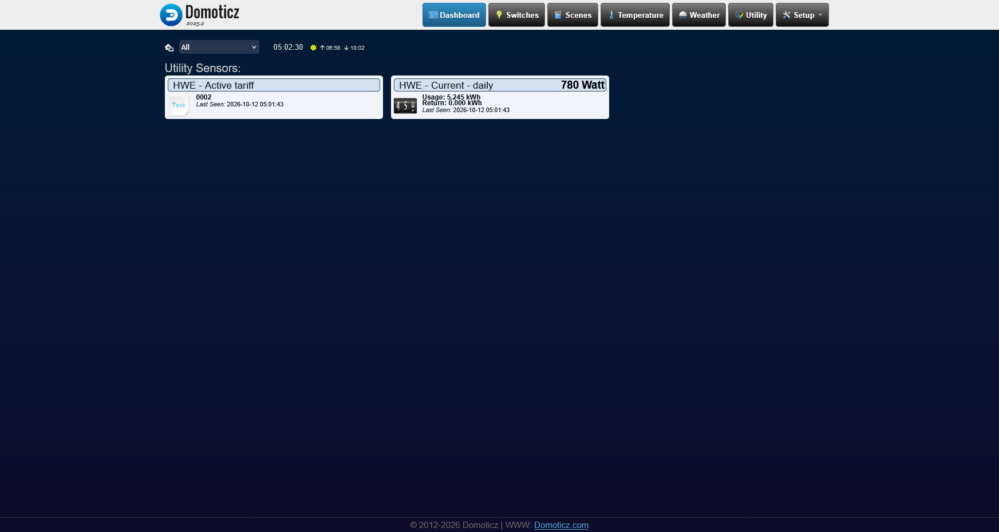
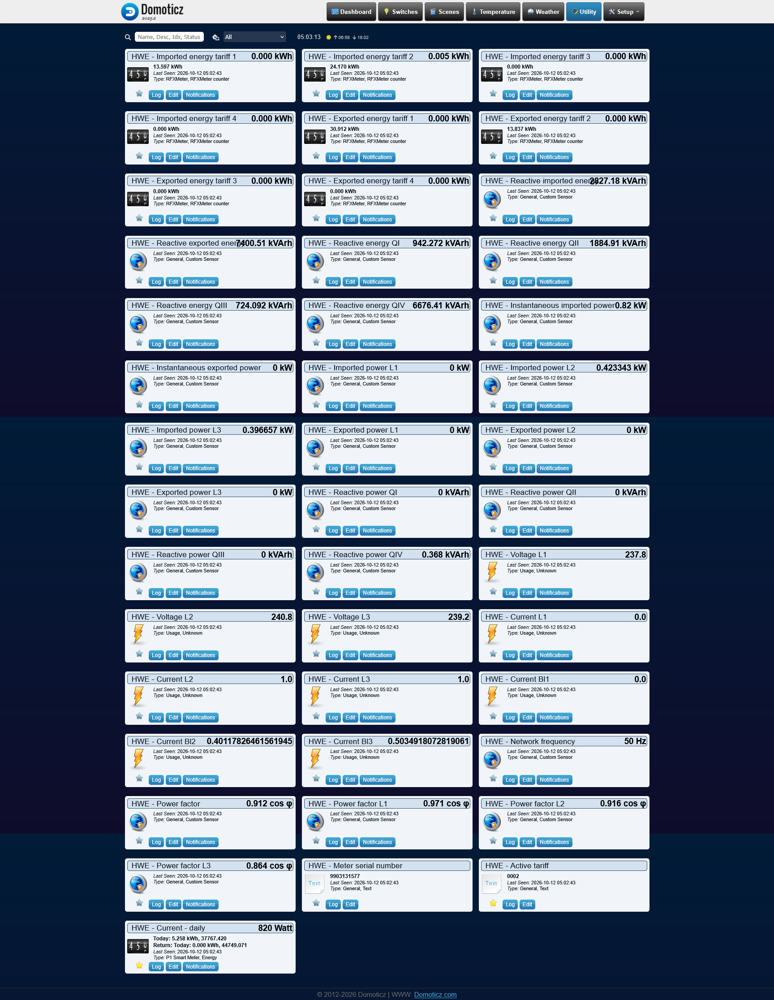
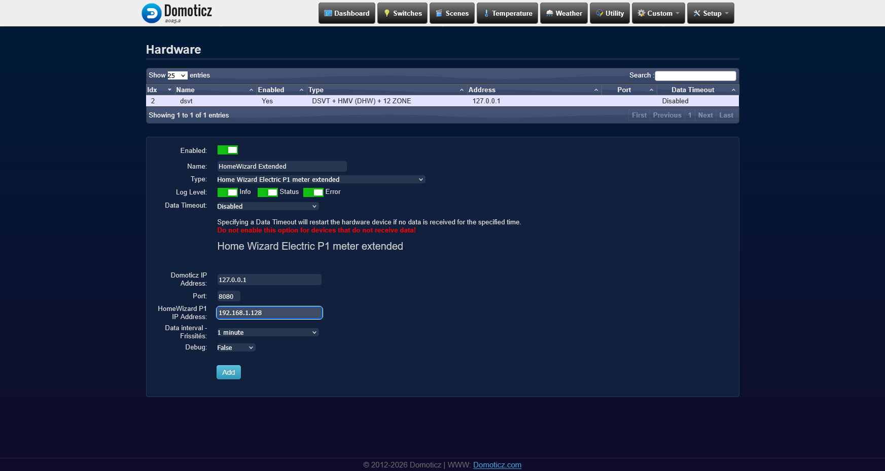

# HomeWizard Wi-Fi P1 Plugin Extended for Domoticz

Extended version of the original HomeWizard Wi-Fi P1 Domoticz plugin with more detailed energy measurements, per-phase electrical data and multi-language support.

Python plugin for Domoticz to integrate the HomeWizard Wi-Fi P1 smart energy meter, including imported and exported energy, electricity tariffs, instantaneous power, voltage, current, reactive energy and other detailed electrical measurements.

This project extends the original HomeWizard P1 plugin with additional measurements, improved device handling and multi-language support.

## Features

Compared to the original HomeWizard Wi-Fi P1 plugin, this Extended version provides:

- Detailed power measurements for each electrical phase (L1, L2, L3)
- Per-phase voltage and current monitoring
- Imported and exported energy measurements by tariff
- Instantaneous imported and exported power
- Reactive energy measurements and power factor values
- Network frequency monitoring
- Active electricity tariff information
- Better handling of import/export values and tariffs
- More consistent device mapping in Domoticz
- Additional calculated values where available
- Improved stability and error handling
- Multi-language support using Domoticz language settings
- Cleaner and more structured device creation
- Designed for reliable long-term operation

The availability of individual measurements depends on the connected electricity meter and the information provided by the HomeWizard P1 interface.

The plugin aims to provide a more complete integration of the HomeWizard P1 meter into Domoticz.

## Screenshots

### Dashboard – Energy monitoring

The plugin integrates HomeWizard P1 energy measurements directly into the Domoticz dashboard.

The dashboard provides a quick overview of current power consumption, daily energy usage and the active electricity tariff.



### Utility – Detailed electrical measurements

The Extended plugin creates a comprehensive set of Domoticz devices for detailed electricity monitoring.

Available measurements include imported and exported energy by tariff, instantaneous power, per-phase voltage and current, reactive energy, power factor and network frequency.

These measurements make it possible to monitor the electrical network in significantly greater detail.



### Hardware – Plugin configuration

The plugin can be configured directly from the Domoticz hardware settings.

The configuration includes the Domoticz connection parameters, HomeWizard P1 IP address and data refresh interval.



## Prerequisites

- Domoticz 2022.1 or newer
- Domoticz with Python plugin support enabled
- HomeWizard Wi-Fi P1 meter connected to the local network
- Network connectivity between Domoticz and the HomeWizard device
- HomeWizard local API enabled, where required by the device firmware

For information about Python plugins, see:

[Domoticz Python Plugins Documentation](https://www.domoticz.com/wiki/Using_Python_plugins)

## Installation

The plugin can be installed manually or by using the [Domoticz Plugins Manager](https://github.com/stas-demydiuk/domoticz-plugins-manager).

### Manual installation

**1. Clone the repository into the Domoticz plugins directory:**

```bash
cd domoticz/plugins
git clone https://github.com/szelessavalapitvany/HomeWizard-Wifi-p1-plugin-Extended
```

Adjust the directory path to match your Domoticz installation.

**2. Restart Domoticz.**

**3. Enable "Accept new Hardware Devices"** in the Domoticz settings.

**4. Open Setup → Hardware.**

**5. Add a new hardware device** using the type:

`Home Wizard Electric P1 meter extended`

**6. Configure the plugin parameters:**

- **Name:** HomeWizard Extended
- **Domoticz IP Address:** 127.0.0.1 (for a local installation)
- **Port:** 8080 (or your configured Domoticz HTTP port)
- **HomeWizard P1 IP Address:** The IP address of your HomeWizard device
- **Data interval – Frissítés:** Select the required data refresh interval
- **Debug:** Enable only when diagnostic information is needed

**7. Click Add** to create the hardware device.

The plugin will create the supported devices in Domoticz and update their measurements periodically.

The available devices depend on the capabilities of the connected smart meter.

## Plugin update

To update the plugin to the latest version:

**1. Open the plugin directory and download the latest changes:**

```bash
cd domoticz/plugins/HomeWizard-Wifi-p1-plugin-Extended
git pull
```

**2. Restart Domoticz.**

### Local modifications

If you modified the plugin files and `git pull` fails because of local changes, you can temporarily save those changes:

```bash
git stash
git pull
```

If you want to restore your local modifications afterward:

```bash
git stash pop
```

Be aware that restoring local modifications may cause merge conflicts.

## Plugin downgrade

If a previous version is required, the repository can be restored to an earlier commit.

**1. Open the plugin directory:**

```bash
cd domoticz/plugins/HomeWizard-Wifi-p1-plugin-Extended
```

**2. Review the available commits:**

```bash
git log --oneline
```

**3. Reset to the required version:**

```bash
git reset --hard <commit_hash>
```

Replace `<commit_hash>` with the selected commit identifier.

**Warning:** `git reset --hard` discards uncommitted changes to tracked files. Back up any local modifications before running this command.

**4. Restart Domoticz.**

Alternatively, disabling and re-enabling the plugin under Setup → Hardware may be sufficient in some situations.

Browser cache cleanup may also be required after interface-related changes.

## Language support

The plugin supports multiple languages and uses the language configured in Domoticz for supported device descriptions.

This allows users to integrate HomeWizard P1 measurements into their existing Domoticz installation without requiring a separate language-specific plugin version.

## Notes

- The HomeWizard P1 device should preferably have a fixed IP address or a DHCP reservation.
- All communication with the HomeWizard P1 meter takes place through the local network.
- Supported measurements vary depending on the smart meter model and its available P1 data.
- Some values may not be available from every electricity meter.
- Enable Debug mode when troubleshooting communication or device creation problems.

## Project

Developed and maintained by **Szélessáv Közhasznú Alapítvány**.

Website: [Szélessáv Műhely](https://www.szelessavmuhely.hu)

GitHub: [HomeWizard-Wifi-p1-plugin-Extended](https://github.com/szelessavalapitvany/HomeWizard-Wifi-p1-plugin-Extended)

---

# HomeWizard Wi-Fi P1 Plugin Extended – Magyar leírás

A HomeWizard Wi-Fi P1 Domoticz plugin kibővített változata, részletesebb villamosenergia-mérési adatokkal, fázisonkénti elektromos jellemzőkkel és többnyelvű támogatással.

Python plugin Domoticzhoz, amely a HomeWizard Wi-Fi P1 okosmérő integrációját valósítja meg.

A plugin segítségével megjeleníthetők az importált és exportált energiamennyiségek, az aktuális teljesítmény, az egyes tarifák, a fázisonkénti feszültség és áramerősség, a meddő energia, valamint további részletes villamosenergia-hálózati adatok.

Ez a projekt az eredeti HomeWizard P1 plugin továbbfejlesztett változata.

## Funkciók

Az eredeti HomeWizard Wi-Fi P1 pluginhoz képest a kibővített változat az alábbi többletfunkciókat biztosítja:

- Részletes, fázisonkénti teljesítménymérés (L1, L2, L3)
- Fázisonkénti feszültség- és áramerősség-értékek
- Importált és exportált energia mérése tarifánként
- Pillanatnyi vételezett és visszatáplált teljesítmény
- Meddőenergia-adatok és teljesítménytényezők
- Hálózati frekvencia figyelése
- Aktuális villamosenergia-tarifa megjelenítése
- Pontosabb import/export és tarifakezelés
- Konzisztensebb és átláthatóbb eszközkezelés a Domoticzban
- További számított értékek, ahol rendelkezésre állnak
- Stabilabb működés és jobb hibakezelés
- Többnyelvű támogatás a Domoticz nyelvi beállításainak felhasználásával
- Letisztultabb és strukturáltabb eszközlétrehozás
- Hosszú távú, megbízható működésre tervezve

Az egyes mérési adatok elérhetősége a csatlakoztatott villamos fogyasztásmérő típusától és a HomeWizard P1 interfész által szolgáltatott információktól függ.

A plugin célja, hogy a HomeWizard P1 mérő teljesebb és részletesebb integrációját biztosítsa a Domoticz rendszerben.

## Képernyőképek

### Dashboard – Energiafogyasztás áttekintése

A plugin a HomeWizard P1 mérő által szolgáltatott adatokat közvetlenül a Domoticz kezelőfelületén jeleníti meg.

A Dashboard oldalon gyorsan áttekinthető a pillanatnyi teljesítményfelvétel, a napi energiafogyasztás és az aktuális villamosenergia-tarifa.


### Utility – Részletes villamosenergia-adatok

A kibővített plugin számos Domoticz mérőeszközt hoz létre, amelyek segítségével részletesen követhető a villamosenergia-hálózat működése.

A megjelenített adatok között megtalálható a tarifánként importált és exportált energiamennyiség, a pillanatnyi teljesítmény, a fázisonkénti feszültség és áramerősség, a meddő energia, a teljesítménytényező és a hálózati frekvencia.


### Hardware – Plugin beállításai

A plugin a Domoticz Setup → Hardware menüpontjában konfigurálható.

Itt adhatók meg a Domoticz kapcsolati paraméterei, a HomeWizard P1 eszköz IP-címe, valamint az adatfrissítés gyakorisága.


## Előfeltételek

- Domoticz 2022.1 vagy újabb verzió
- Engedélyezett Python plugin támogatás
- Helyi hálózathoz csatlakoztatott HomeWizard Wi-Fi P1 mérő
- Hálózati kapcsolat a Domoticz és a HomeWizard eszköz között
- A HomeWizard helyi API engedélyezése, amennyiben azt az eszköz firmware-verziója megköveteli

A Python pluginokról további információ:

[Domoticz Python plugin dokumentáció](https://www.domoticz.com/wiki/Using_Python_plugins)

## Telepítés

A plugin telepíthető manuálisan vagy a [Domoticz Plugins Manager](https://github.com/stas-demydiuk/domoticz-plugins-manager) segítségével.

### Manuális telepítés

**1. Másold vagy klónozd a plugint a Domoticz plugins könyvtárába:**

```bash
cd domoticz/plugins
git clone https://github.com/szelessavalapitvany/HomeWizard-Wifi-p1-plugin-Extended
```

A könyvtár elérési útját a saját Domoticz telepítésednek megfelelően állítsd be.

**2. Indítsd újra a Domoticzot.**

**3. Ellenőrizd, hogy az „Accept new Hardware Devices” beállítás engedélyezve van-e.**

**4. Lépj a Setup → Hardware menüpontba.**

**5. Adj hozzá új hardvert az alábbi típussal:**

`Home Wizard Electric P1 meter extended`

**6. Állítsd be a szükséges paramétereket:**

- **Name:** HomeWizard Extended
- **Domoticz IP Address:** 127.0.0.1 (helyi telepítés esetén)
- **Port:** 8080 (vagy a Domoticz beállított HTTP-portja)
- **HomeWizard P1 IP Address:** A HomeWizard eszköz IP-címe
- **Data interval – Frissítés:** Az adatok lekérdezésének gyakorisága
- **Debug:** Hibakeresés esetén engedélyezhető

**7. Kattints az Add gombra** a hardver létrehozásához.

A plugin létrehozza a támogatott mérőeszközöket a Domoticzban, majd a beállított időközönként frissíti azok adatait.

Az elérhető mérési értékek a csatlakoztatott villamos fogyasztásmérő képességeitől függnek.

## Plugin frissítése

A plugin legújabb verzióra történő frissítéséhez:

**1. Lépj be a plugin könyvtárába és töltsd le a legújabb módosításokat:**

```bash
cd domoticz/plugins/HomeWizard-Wifi-p1-plugin-Extended
git pull
```

**2. Indítsd újra a Domoticzot.**

### Helyi módosítások kezelése

Ha a plugin fájljait korábban módosítottad, és emiatt a `git pull` nem fut le, a helyi módosításokat ideiglenesen eltárolhatod:

```bash
git stash
git pull
```

A korábbi helyi módosítások visszaállításához:

```bash
git stash pop
```

A helyi módosítások visszaállítása bizonyos esetekben ütközéseket okozhat.

## Plugin visszaléptetése (downgrade)

Szükség esetén a plugin egy korábbi verziója is visszaállítható.

**1. Lépj be a plugin könyvtárába:**

```bash
cd domoticz/plugins/HomeWizard-Wifi-p1-plugin-Extended
```

**2. Tekintsd meg a korábbi verziókat:**

```bash
git log --oneline
```

**3. Állítsd vissza a kívánt verziót:**

```bash
git reset --hard <commit_hash>
```

A `<commit_hash>` helyére a visszaállítani kívánt verzió commitazonosítóját kell beírni.

**Figyelem:** A `git reset --hard` visszavonhatatlanul eldobja a követett fájlokon végzett, még nem mentett helyi módosításokat. A parancs futtatása előtt célszerű biztonsági mentést készíteni.

**4. Indítsd újra a Domoticzot.**

Bizonyos esetekben elegendő lehet a plugin letiltása, majd ismételt engedélyezése a Setup → Hardware menüpontban.

A kezelőfelületet érintő változtatások után szükség lehet a böngésző gyorsítótárának törlésére is.

## Többnyelvű támogatás

A plugin több nyelvet támogat, és a Domoticzban beállított nyelvet használja a támogatott eszközleírásokhoz.

Így ugyanaz a plugin külön nyelvi változat telepítése nélkül használható különböző nyelvű Domoticz rendszerekben.

## Megjegyzések

- A HomeWizard P1 eszköz számára célszerű fix IP-címet vagy DHCP-foglalást beállítani.
- A HomeWizard P1 mérővel történő kommunikáció a helyi hálózaton keresztül valósul meg.
- Az elérhető mérési adatok a villamos fogyasztásmérő típusától és a P1 interfész által biztosított információktól függnek.
- Egyes mérési értékek bizonyos fogyasztásmérőknél nem állnak rendelkezésre.
- Kommunikációs vagy eszközlétrehozási hibák esetén érdemes a Debug módot engedélyezni.

## Projekt

Fejlesztő és karbantartó: **Szélessáv Közhasznú Alapítvány**

Weboldal: [Szélessáv Műhely](https://www.szelessavmuhely.hu)

GitHub: [HomeWizard-Wifi-p1-plugin-Extended](https://github.com/szelessavalapitvany/HomeWizard-Wifi-p1-plugin-Extended)
